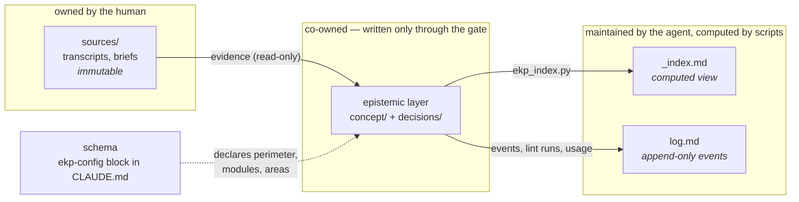
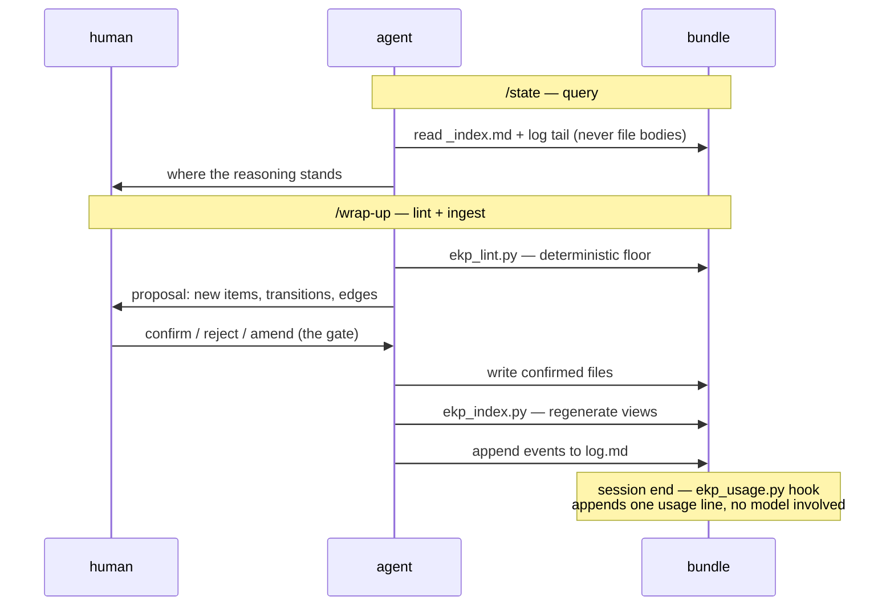
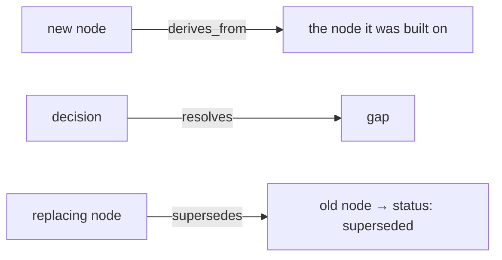

# EKP — Epistemic Knowledge Profile

A way to write down not only what a project has decided, but how sure it
is, what it is assuming, and what would make it change its mind — in plain
markdown files that people and agents can both read.

EKP is a profile of Google's [Open Knowledge Format (OKF)](https://github.com/GoogleCloudPlatform/knowledge-catalog/blob/main/okf/SPEC.md):
every EKP file is also a valid OKF document. It adds what OKF leaves out on
purpose — epistemic status, a lifecycle, typed links between items, and
review triggers.

## Why it exists

I started it as a personal tool. Working with agents, I was taking many
more decisions in much less time, and losing the thread: what I had
chosen, what was still open, how sure I was, where I wanted to go. The
system mirrors the categories I already used to organise project
knowledge — gaps, assumptions, insights, opportunities, hypotheses,
constraints and decisions — linked to each other and to the conditions
that should reopen them.

On two projects it left my head and became a shared working constraint.
A colleague read one of my decisions, checked it against the code and
contested it; a new decision superseded it. The contested one was not
deleted — it stays in the bundle as `superseded`, with the disagreement
on record. That is deliberate: kept disagreements and superseded
decisions strengthen the decisions that replaced them, because the new
one carries the trace of what it had to answer. A reviewer agent with
access only to constraints and decisions, not to the code, blocked an
implementation that violated them. This repository is the system, as it
stands, released together with the limits I know about. It accompanies
the talk *Progettare ad alta voce* (WUDRome 2026).

The talk leaves two questions open, and this repo inherits them: a
system like this seems to offer affordances for contestation — it opens
surfaces where decisions can be challenged. Does it, really? And how do
those surfaces extend to the people the decisions fall on, who have no
access to the bundle?

## Contents

| Path | What it is |
|------|-----------|
| [`SPEC.md`](SPEC.md) | The profile: conformance levels L0–L3, the seven categories and their lifecycles, three edge types, operations and layer contracts |
| [`templates/`](templates/) | One template per category, plus `SCHEMA_template.md`: the configuration block to paste into the project instruction file |
| [`commands/`](commands/) | `/state` (load where the reasoning stands) and `/wrap-up` (lint, propose, write only after confirmation), written as Claude Code commands |
| [`scripts/ekp_lint.py`](scripts/ekp_lint.py) | Deterministic linter for the checks a script can do. Read-only, Python 3 standard library only |
| [`scripts/ekp_index.py`](scripts/ekp_index.py) | Regenerates the computed index from frontmatter: per-status listings, back-references, Mermaid graph. `--check` verifies staleness without writing |
| [`scripts/ekp_usage.py`](scripts/ekp_usage.py) | Deterministic token accounting: appends one `usage` line per session to the log, from the session transcript. Runs as a Claude Code `SessionEnd` hook |
| [`tests/`](tests/) | Contract tests for the scripts (`python3 -m unittest discover -s tests`): the example bundle must lint clean, a dirty fixture must trigger every finding class |
| [`examples/neighbourhood-library/`](examples/neighbourhood-library/) | A small synthetic bundle at level L2: a library redesigns how its study rooms are booked |
| [`docs/how-it-works.md`](docs/how-it-works.md) | How EKP works, for readers who don't write code: the kinds of note, how they connect, a working session, who checks what, the project settings |
| [`CHANGELOG.md`](CHANGELOG.md) | Versions and what changed in each. One version number covers spec, templates, commands and scripts |

## The system at a glance

New to EKP, or not technical? Start from [How EKP works](docs/how-it-works.md):
the same system explained step by step, with an example.

Five layers, each with an owner and a write discipline (SPEC §8.1). The
epistemic layer is the only co-owned one: the agent proposes, the human
confirms — that confirmation step is **the gate**.



The two operations route through those layers. Scripts do the
bookkeeping (lint floor, views, token accounting); the model does the
judgment; nothing durable is written without a yes:



Relationships are three typed edges, always stored on the downstream
node; the upstream file holds no forward link, and the index computes
the reverse reading (SPEC §5). The graph they form is whatever emerges —
EKP encodes no pipeline and no canonical ordering:



## Try it

You need Python 3.9 or later (standard library only, nothing to
install), a Bash or zsh shell, and a copy of this repository: clone it,
or download a release. Install from a release tag or from `main`: a
commit on another branch may later disappear.

The commands below use two folders: your copy of EKP and your project.
Set their paths first, replacing the examples with your own:

```bash
ekp_source="/absolute/path/to/epistemic-knowledge-profile"
project_dir="/absolute/path/to/your-project"

# 1. look at the example and lint it
cd "$ekp_source"
python3 scripts/ekp_lint.py examples/neighbourhood-library

# 2. in your project: create the folders of the epistemic layer, with a
#    .gitkeep in each so git keeps them while they're empty
cd "$project_dir"
mkdir -p concept/{gaps,assumptions,opportunities,hypotheses,constraints,insights} decisions
for d in concept/*/ decisions/; do touch "$d.gitkeep"; done
```

**Before step 3, check for clashes.** Step 3 copies files into
`scripts/`, `templates/` and `.claude/commands/`, and `cp` overwrites any
file with the same name without asking. EKP's files are `ekp_*.py`,
`*_template.md`, `state.md` and `wrap-up.md`. If your project already has
files with those names in those folders, stop and rename yours first.
Other files in the folders are left alone.

```bash
# 3. copy the scripts and the templates, and the commands if you use Claude Code
mkdir -p scripts templates .claude/commands
cp "$ekp_source"/scripts/*.py scripts/
cp "$ekp_source"/templates/*.md templates/
cp "$ekp_source"/commands/*.md .claude/commands/

# 4. create the log and the first (empty) index, which /state reads
touch log.md
python3 scripts/ekp_index.py .
```

`/wrap-up` writes new items from `templates/`, so the folder has to be in
the project, not only in the EKP repository.

**5. Add the configuration to your instruction file.** Open
`templates/SCHEMA_template.md` and copy all of it, from the
`# EKP configuration` heading to the end, into your project's instruction
file: `CLAUDE.md` for Claude Code, `AGENTS.md` or equivalent for other
tools. If the file doesn't exist, create it; if it does, add the text at
the end. Then replace the three placeholders:

- `[PROJECT_NAME]` in the heading: your project's name;
- `vX.Y.Z` after `ekp_version:`: the output of
  `git -C "$ekp_source" describe --tags --always`, or the release tag you
  downloaded if your copy isn't a git clone;
- the last bullet, `[Project-specific conventions: …]`: your own
  conventions (language, naming, where the domain documents are), or
  delete it.

Keep the fenced `yaml` block that starts with `# ekp-config` as the first
`yaml` block after the heading: the commands look for it there. Bundles
installed at different times drift apart silently; the recorded version
says which [CHANGELOG](CHANGELOG.md) entries apply.

**6. Check the install.** From the project folder:

```bash
ls concept                               # look: all six category folders
python3 scripts/ekp_lint.py .            # Errors: 0 (0 files is right for a new bundle)
python3 scripts/ekp_index.py . --check   # ok: decisions/_index.md is up to date
grep -n "^ekp_version:" CLAUDE.md        # look: a real version, not vX.Y.Z
                                         # (use AGENTS.md if you chose it in step 5)
```

Two of these checks are by eye: a clean exit doesn't prove that all six
folders are there, or that the version was filled in. Read the output of
the first and the last line. The linter can't tell an empty bundle from
missing folders yet ([#19](../../issues/19)).

You don't need the whole thing on day one: level L0 costs one `type:`
field per file, L1 adds `id` and `status`, L2 adds the links.

The linter exits with 0 when the bundle is clean, 1 with warnings only,
2 with errors. Add `--json` for machine-readable output.

To also record what each session uses, add the usage hook to the
project's `.claude/settings.json` (Claude Code only). It appends a line
with the session's token counts to the existing `log.md`, computed from
the transcript, no model involved:

```json
{"hooks": {"SessionEnd": [{"hooks": [
    {"type": "command", "command": "python3 scripts/ekp_usage.py"}]}]}}
```

If the file already exists, merge this into it and keep everything else:

- no `"hooks"` key yet: add the whole `"hooks"` object;
- `"hooks"` but no `"SessionEnd"`: add the `"SessionEnd"` array;
- `"SessionEnd"` already there: append the inner object
  (`{"hooks": [{"type": "command", "command": "python3 scripts/ekp_usage.py"}]}`)
  to its array. Don't add a second `"SessionEnd"` key and don't replace
  the existing entries.

The command path is relative: it works when Claude Code runs from the
project folder.

### Without the system

Three gestures you can try on Monday, with no files and no agents:
separate what you know from what you are assuming; for every decision,
write down why you took it, how sure you are and what would make you
change your mind; and put it where others — people and agents — read it.

## Known limits

- **It records when and where an idea was born, not who proposed it.**
  Ideas from people have a name; ideas from an agent don't. Confirming is
  not writing, and responsibility without provenance can't be verified.
  The next version should separate who answers for an item from where it
  comes from. This is [issue #1](../../issues/1).
- **To contest a decision you have to be able to read it.** A bundle
  helps only where the people affected can open it. Even inside a team,
  access is fragile.
- **The categories measure certainty and direction, not who a choice is
  good for, or at whose expense.** They are all written in the first
  person plural. The system doesn't say who is left out of that "we".

Try it on your projects and tell me where it doesn't hold. Issues are
the right place, in English or in Italian.

## Licence

Text — the specification, templates, commands, documentation and
example — is released under [CC BY 4.0](LICENSE). Code in `scripts/` is
released under the [MIT licence](LICENSE-CODE).
