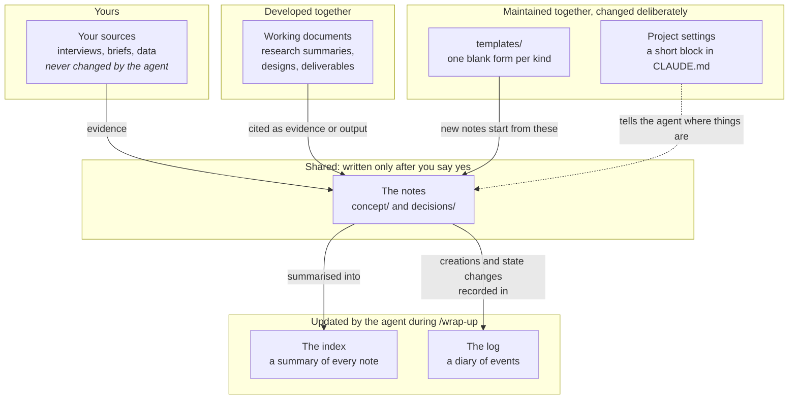
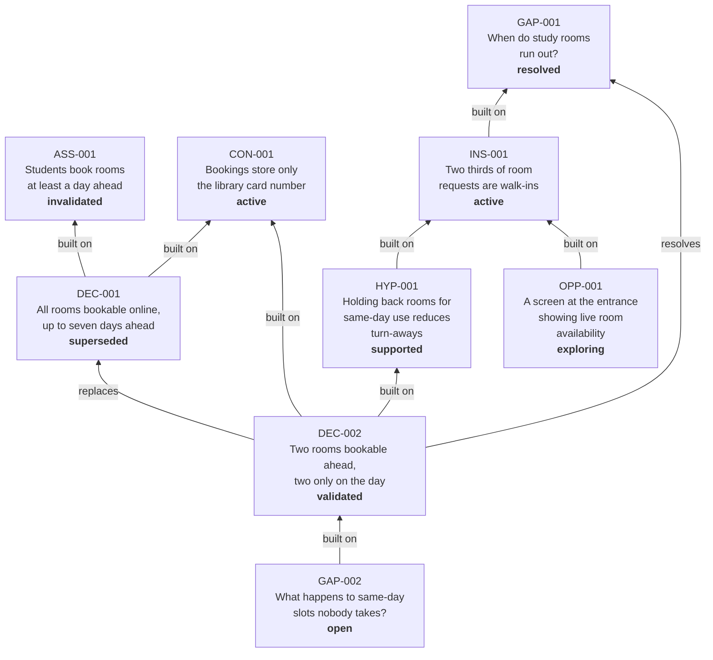
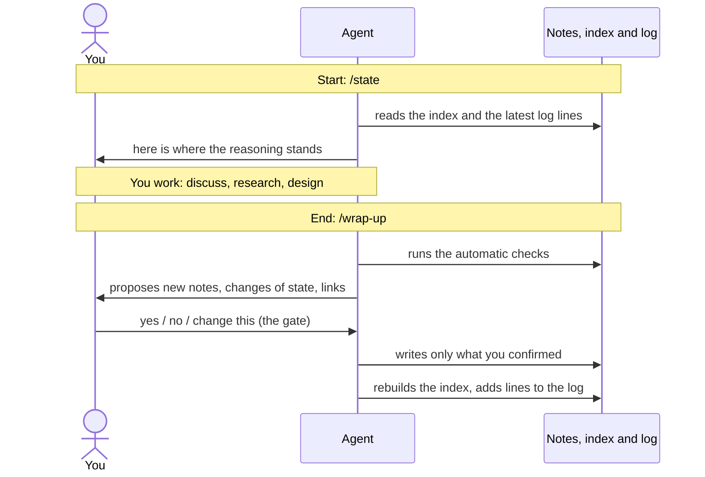
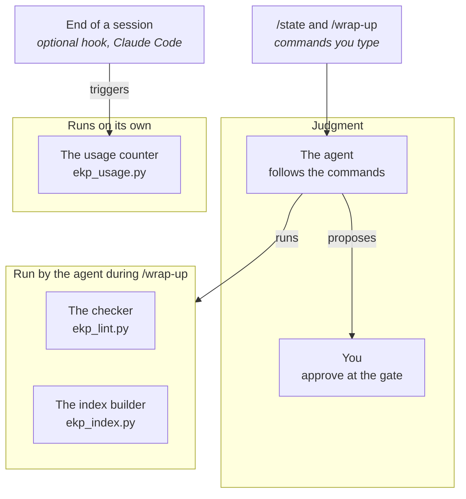

# How EKP works

EKP (Epistemic Knowledge Profile) is a way to record what a project
knows, assumes, questions and decides. This page explains it without
assuming you write code. It covers what
the files are, how they connect, what happens during a working session,
and which parts are checked automatically. The precise rules are in the
[specification](../SPEC.md); this page is the way in.

## The idea in one paragraph

A project makes many choices, and each one rests on something: a fact,
a guess, a limit, a question still open. Usually only the choice gets
written down, and over time nobody remembers why it was made or how sure
anyone was. EKP writes down the reasoning too, one short file per piece,
and links the pieces together. People can read it, and so can the AI
agents that work on the project with them.

## Seven kinds of note

Every note is one of seven kinds. Each kind answers a different
question, and each has a small set of states it can be in.

| Kind | The question it answers | Example states |
|------|-------------------------|----------------|
| **Gap** | What don't we know yet? | open → resolved |
| **Assumption** | What are we taking for granted? | open → validated or invalidated |
| **Insight** | What have we learned? | active |
| **Opportunity** | What could we do? | unexplored → exploring → committed |
| **Hypothesis** | What do we think will happen, and can we test it? | untested → supported or refuted |
| **Constraint** | What limits must every solution respect? | active → removed |
| **Decision** | What did we choose, and why? | open → validated or invalidated |

These are example states, not all of them. A few words on what they
mean: *supported* means the evidence backs a hypothesis so far, not that
it is settled for good; an assumption *validated* by evidence is still
labelled an assumption, while an insight starts from evidence. Any note
can also end up **superseded**: replaced by a newer one, but kept, so the
old reasoning stays readable.

## What a note looks like

A note is a short text file. It has two parts:

- **A header** at the top, a few labelled lines: the kind of note, its
  reference number, a title, its current state and its links to other
  notes. Being labelled, these lines can be read by people and by
  programs.
- **The body**: ordinary prose. The idea or the choice, the evidence or
  reasoning behind it, and what would make you look at it again.

That last part matters most. Notes can record what would make you
reconsider them, and decisions always do, in a section called *review
triggers*. For example, the decision
[DEC-002](../examples/neighbourhood-library/decisions/DEC-002_split-booking.md)
in the example below says: if the same-day rooms stay empty more than
40% of opening hours for two months, reconsider the split. A decision
that was sound can become one to revisit, and the note says in advance
what would show it.

## What's in a project

A project that uses EKP has a few extra folders and files. Each has an
owner, and the owner decides who may write there.

A note on notation, used from here on: names ending in `/` are folders;
names ending in `.md` are readable text files. `CLAUDE.md` is the file
with the project's instructions for the AI assistant. `/state` and
`/wrap-up` look similar to folder names but are not: they are requests
you type to the assistant.

- **The notes** are the heart of it. `concept/` holds the first six
  kinds, one subfolder each. `decisions/` holds the decisions.
- **The index** is a summary page, so nobody has to open every note to
  see where things stand. A script rebuilds it; nobody edits it by hand.
- **The log** is a diary: one line for every note created and every
  change of state, with the date. Lines are only ever added.
- **Working documents** are the everyday work: research summaries,
  designs, deliverables. You and the agent develop them together, and
  notes can cite them as evidence or as the output of a decision. Raw
  sources, by contrast, stay unchanged.
- **The settings and the templates** shape the whole project, so they
  are maintained together and changed deliberately, with the change
  written down.
- **The kit** is what you copy from this repository when you install
  EKP: the templates, a few scripts and two commands.

## How notes connect

Notes point to each other in only three ways:

- **built on**: this note came from that one;
- **resolves**: this decision answers that gap;
- **replaces**: this note takes the place of that one.

Each link is written in the note that builds on, answers or replaces
the other one, never in both. The other note doesn't have to be edited:
the index works out the reverse reading for you ("what was built on
this?"). Links can be added between notes that already exist, and they
don't have to follow a fixed sequence.

Here is the fictional example in
[`examples/neighbourhood-library`](../examples/neighbourhood-library/):
a library deciding how its study rooms are booked. Each note has a
reference number: the letters name its kind (GAP, ASS for assumption,
CON for constraint, DEC, INS, HYP, OPP) and the number identifies it.
Read each arrow as "this note *built on / resolves / replaces* that
note". The word in bold is the note's current state.

Older notes sit at the top and newer ones below, so the diagram reads
from top to bottom in roughly the order things happened.

Read it as a story. The library assumed students book ahead (ASS-001)
and decided to put every room online (DEC-001). Front-desk records showed
that most requests are walk-ins (INS-001), so the assumption turned out
wrong. A pilot supported keeping some rooms for the same day (HYP-001),
and a new decision replaced the first one (DEC-002). That decision
answered the original question (GAP-001) and raised a new one (GAP-002).
DEC-001 is still there, marked superseded: anyone can see what was tried
and why it changed. Two notes run alongside the story: the privacy
constraint (CON-001) applies to both decisions, and the entrance screen
(OPP-001) is still only an opportunity being explored.

## A working session

This way of working needs an AI assistant that can read and write
files in your project (an *agent*), not only chat. Once EKP is set up,
you type `/state` in the conversation with the assistant to get a
briefing, you work together as usual, and you type `/wrap-up` to review
what should be saved. The commands supplied with EKP are written for
Claude Code; other tools need an equivalent setup.
([Setup instructions](../README.md#try-it): you may want help with this
part.)

The most important step is **the gate**. EKP instructs the agent to ask
before adding or changing a note: it proposes, you decide. The gate is a
working agreement written into the commands, not a lock: it holds
because the agent follows the procedure and you check what it proposes. These notes record what you believe, what is still uncertain and
what you have chosen. You decide how that shared record changes.

## Commands, scripts and hooks: who does what

EKP splits the work between judgment and bookkeeping. Judgment
(is this really an insight? is this decision still sound?) belongs to
you and the agent. Bookkeeping (are the files well formed? is the index
current?) is done by small programs that give the same answer every
time, whatever model is running.

The three programs at the bottom do bookkeeping: given the same files,
they give the same answer every time they run.

- **A command** is a written procedure the agent follows when you type
  it, like `/wrap-up`. It's a recipe: the agent reads it and does the
  steps, using its judgment where the recipe asks for it. (Some tools
  call these *skills*; the idea is the same.)
- **A script** is a small program. It doesn't interpret anything: given
  the same files, it always gives the same result. EKP has three: the
  checker, the index builder and the usage counter.
- **A hook** is a rule in your AI tool's settings: "when this happens,
  run that". It fires on its own, without the agent deciding. EKP
  currently offers one, optional, for Claude Code: once you add it to
  the tool's settings, it adds a line to the existing log when a session
  ends, with the session's token counts (tokens are
  the units AI tools use to measure what they read and write). It
  doesn't calculate a price. A second hook is proposed
  ([#20](https://github.com/AhUhmm/epistemic-knowledge-profile/issues/20)):
  check every note right after it's written.

The split matters because an agent can be wrong. The scripts give the
same answer every time they run, but today it's the agent that runs the
checker and the index builder, during `/wrap-up`. If it skips those
steps, the checks don't happen. Only the optional usage hook runs on its
own.

## Project settings

Each project has a short settings block in its instruction file
(`CLAUDE.md`, or `AGENTS.md` for other tools). It starts with
`# ekp-config`. The blank version is in
[`templates/SCHEMA_template.md`](../templates/SCHEMA_template.md).

| Setting | What it says | Who reads it today | Safe to change? |
|---------|--------------|--------------------|-----------------|
| `ekp_version` | Which EKP release the project was installed from | People and agents, when upgrading; no script | Yes: update it when you upgrade |
| `perimeter` | Which folders hold the notes | The agent only | **No**: the scripts look in `concept/` and `decisions/` regardless ([#19](https://github.com/AhUhmm/epistemic-knowledge-profile/issues/19)) |
| `modules` | Optional procedures, such as a handover note for the next session (`continuity`) or links to your issue tracker (`integrations`) | The agent | Yes, once the procedure is set up for your project |
| `areas` | The topics you group notes by, e.g. strategy, research | The agent | Yes: add new ones freely |
| `extensions` | Extra fields your project adds to notes, each with the rule that uses it. For example, a `risk` field is worth adding only if high-risk notes are treated differently | The agent | Yes, as long as each has a rule |
| `log` | Where the log file is | The agent and the usage counter | **No**: the checker still reads `log.md` |
| `index` | Where the index file is | The agent | **No**: the checker assumes `decisions/_index.md`, and the index builder uses it unless told otherwise |

Until [#19](https://github.com/AhUhmm/epistemic-knowledge-profile/issues/19)
is solved, keep the folder and file locations as they are. Add topic
names whenever you need them; switch on procedures and extra fields
deliberately. Update `ekp_version` only after the upgrade is done,
including any changes the [changelog](../CHANGELOG.md) asks for.

## Words used on this page

- **Bundle**: all the notes of one project, with their index and log.
- **Note** (in the specification: *item* or *unit*): one file, one piece
  of reasoning.
- **Link** (in the specification: *edge*): built on, resolves, replaces.
- **State** (in the specification: *status*): where a note is in its
  life, e.g. open or validated.
- **The gate**: your explicit approval of the notes the agent proposes,
  before it writes them. The optional usage line in the log is added
  separately, without asking.
