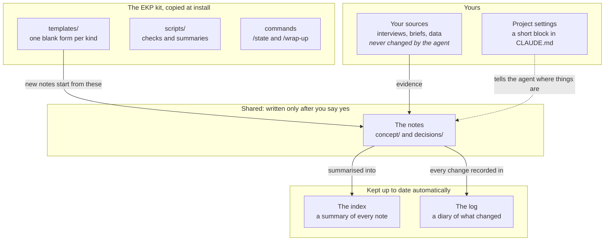
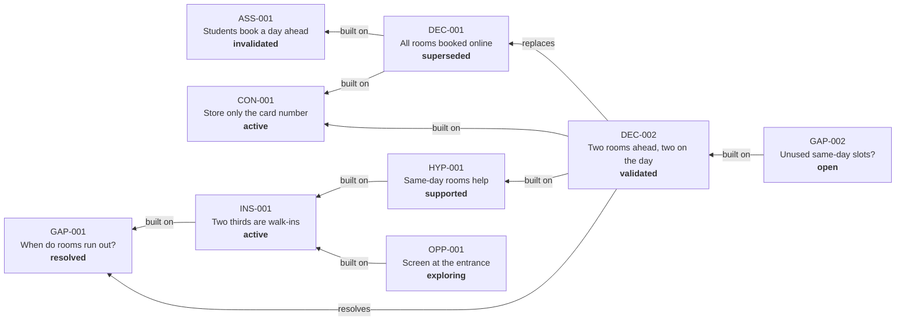
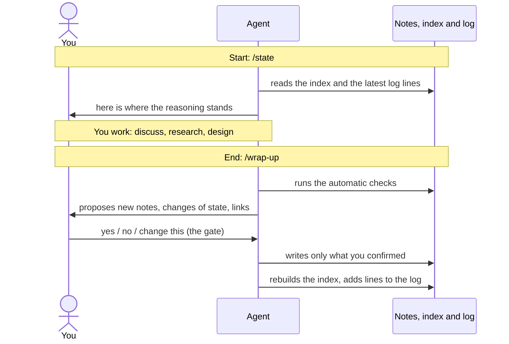
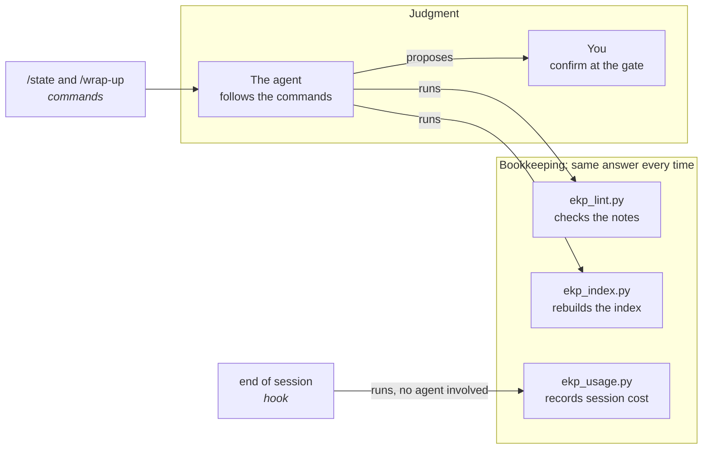

# How EKP works

This page explains EKP without assuming you write code. It covers what
the files are, how they connect, what happens during a working session,
and which parts are checked automatically. The precise rules are in the
[specification](../SPEC.md); this page is the way in.

## The idea in one paragraph

A project makes many choices, and each one rests on something: a fact,
a guess, a limit, a question still open. Usually only the choice gets
written down, and over time nobody remembers why it was made or how sure
anyone was. EKP writes down the reasoning too, one short file per piece,
and links the pieces together. People can read it, and so can the AI
agents that work on the project with them.

## Seven kinds of note

Every note is one of seven kinds. Each kind answers a different
question, and each has a small set of states it can be in.

| Kind | The question it answers | Example states |
|------|-------------------------|----------------|
| **Gap** | What don't we know yet? | open → resolved |
| **Assumption** | What are we taking for granted? | open → validated or invalidated |
| **Insight** | What have we learned? | active |
| **Opportunity** | What could we do? | unexplored → exploring → committed |
| **Hypothesis** | What do we think will happen, and can we test it? | untested → supported or refuted |
| **Constraint** | What limits must every solution respect? | active → removed |
| **Decision** | What did we choose, and why? | open → validated or invalidated |

Any note can also end up **superseded**: replaced by a newer one, but
kept, so the old reasoning stays readable.

## What's in a project

A project that uses EKP has a few extra folders and files. Each has an
owner, and the owner decides who may write there.

- **The notes** are the heart of it. `concept/` holds the first six
  kinds, one subfolder each. `decisions/` holds the decisions.
- **The index** is a summary page, so nobody has to open every note to
  see where things stand. A script rebuilds it; nobody edits it by hand.
- **The log** is a diary: one line for every note created and every
  change of state, with the date. Lines are only ever added.
- **The kit** is what you copy from this repository when you install
  EKP: blank forms, scripts and two commands.

## How notes connect

Notes point to each other in only three ways:

- **built on**: this note came from that one;
- **resolves**: this decision answers that gap;
- **replaces**: this note takes the place of that one.

The link is always written in the newer note, pointing back at the older
one. The older note never has to be edited when something new builds on
it. The index works out the reverse reading for you ("what was built on
this?").

Here is the example in [`examples/neighbourhood-library`](../examples/neighbourhood-library/),
a library deciding how its study rooms are booked:

Read it as a story. The library assumed students book ahead (ASS-001)
and decided to put every room online (DEC-001). Front-desk records showed
that most requests are walk-ins (INS-001), so the assumption turned out
wrong. A pilot supported keeping some rooms for the same day (HYP-001),
and a new decision replaced the first one (DEC-002). That decision
answered the original question (GAP-001) and raised a new one (GAP-002).
DEC-001 is still there, marked superseded: anyone can see what was tried
and why it changed.

## A working session

You work with an AI agent as usual. EKP adds two moments: one at the
start and one at the end.

The most important step is **the gate**. The agent never adds or changes
a note on its own: it proposes, you decide. A note is a commitment ("we
believe this", "we chose this"), and commitments need a person behind
them.

## Commands, scripts and hooks: who does what

EKP splits the work between judgment and bookkeeping. Judgment
(is this really an insight? is this decision still sound?) belongs to
you and the agent. Bookkeeping (are the files well formed? is the index
current?) is done by small programs that give the same answer every
time, whatever model is running.

- **A command** is a written procedure the agent follows when you type
  it, like `/wrap-up`. It's a recipe: the agent reads it and does the
  steps, using its judgment where the recipe asks for it. (Some tools
  call these *skills*; the idea is the same.)
- **A script** is a small program. It doesn't interpret anything: given
  the same files, it always gives the same result. EKP has three: the
  checker, the index builder and the usage counter.
- **A hook** is a rule in your AI tool's settings: "when this happens,
  run that". It fires on its own, without the agent deciding. EKP
  currently offers one, optional: at the end of each session, add a line
  to the log with what the session cost. A second one is planned
  ([#20](https://github.com/AhUhmm/epistemic-knowledge-profile/issues/20)): check every note right after it's written.

The split matters because an agent can be wrong, or skip a step. The
scripts are the floor that holds anyway.

## Project settings

Each project has a short settings block in its instruction file
(`CLAUDE.md`, or `AGENTS.md` for other tools). It starts with
`# ekp-config`. The blank version is in
[`templates/SCHEMA_template.md`](../templates/SCHEMA_template.md).

| Setting | What it says | Who reads it today | Safe to change? |
|---------|--------------|--------------------|-----------------|
| `ekp_version` | Which EKP release the project was installed from | People, when upgrading | Yes: update it when you upgrade |
| `perimeter` | Which folders hold the notes | The agent only | **No**: the scripts look in `concept/` and `decisions/` regardless ([#19](https://github.com/AhUhmm/epistemic-knowledge-profile/issues/19)) |
| `modules` | Optional extras that are switched on | The agent | Yes |
| `areas` | The topics you group notes by, e.g. strategy, research | The agent | Yes: add new ones freely |
| `extensions` | Extra fields your project adds, and the rule that uses each | The agent | Yes, as long as each has a rule |
| `log` | Where the log file is | The agent and the usage counter | **No**: the checker still reads `log.md` |
| `index` | Where the index file is | The agent | **No**: the scripts use `decisions/_index.md` |

Until [#19](https://github.com/AhUhmm/epistemic-knowledge-profile/issues/19) is solved, keep the folder and file
locations as they are, and change the rest freely.

## Words used on this page

- **Bundle**: all the notes of one project, with their index and log.
- **Note** (in the specification: *item* or *unit*): one file, one piece
  of reasoning.
- **Link** (in the specification: *edge*): built on, resolves, replaces.
- **State** (in the specification: *status*): where a note is in its
  life, e.g. open or validated.
- **The gate**: the moment you confirm what the agent proposes. Nothing
  is written without it.
