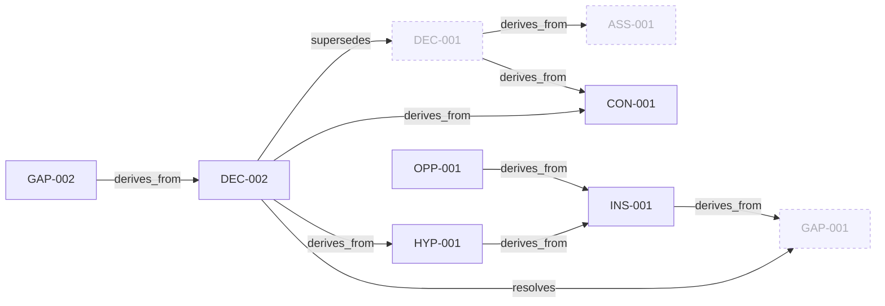

# Index (computed view)

<!-- Regenerated at wrap-up from frontmatter (scripts/ekp_index.py).
Never edit by hand: if this file and a source file disagree, the
source file wins (SPEC §5.4). -->

## Decisions by status

| ID | Title | Status | Area |
|----|-------|--------|------|
| DEC-002 | Two rooms bookable ahead, two only on the day | validated | service-design |
| DEC-001 | All rooms bookable online, up to seven days ahead | superseded | service-design |

## Concept items by status

| ID | Title | Status |
|----|-------|--------|
| GAP-002 | What happens to same-day slots nobody takes? | open |
| OPP-001 | A screen at the entrance showing live room availability | exploring |
| HYP-001 | Holding back rooms for same-day use reduces turn-aways | supported |
| CON-001 | Bookings store only the library card number | active |
| INS-001 | Two thirds of room requests are walk-ins | active |
| GAP-001 | When do study rooms run out? | resolved |
| ASS-001 | Students book rooms at least a day ahead | invalidated |

## By area

- **data** — CON-001
- **service-design** — GAP-001, GAP-002, ASS-001, OPP-001, HYP-001, INS-001, DEC-001, DEC-002

## Back-references (computed, never stored upstream)

- GAP-001 — derived by INS-001; resolved by DEC-002
- ASS-001 — derived by DEC-001
- HYP-001 — derived by DEC-002
- CON-001 — derived by DEC-001, DEC-002
- INS-001 — derived by OPP-001, HYP-001
- DEC-001 — superseded by DEC-002
- DEC-002 — derived by GAP-002

## Graph (computed)

